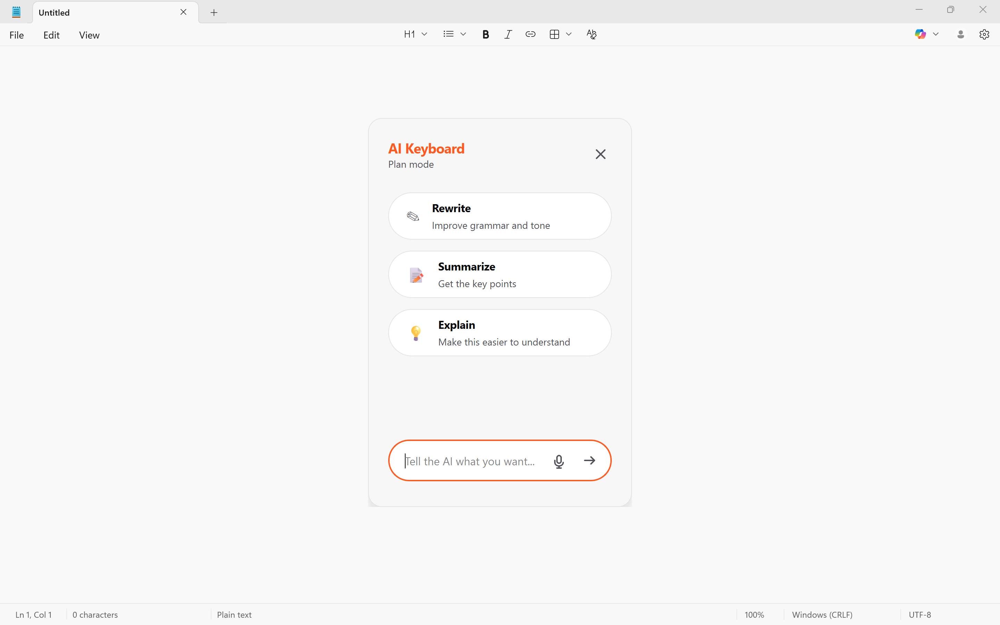
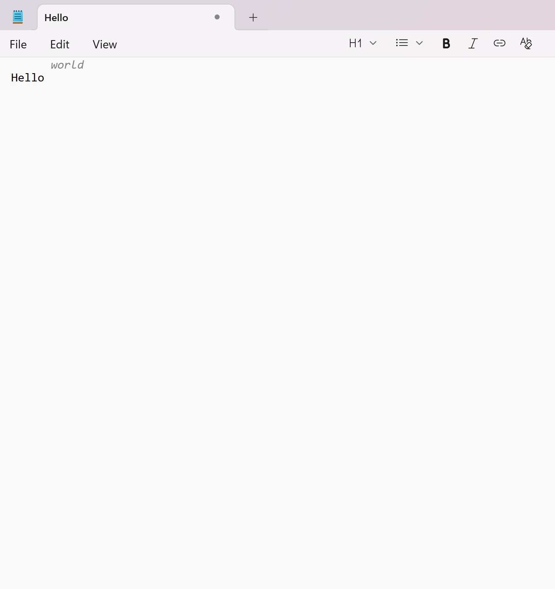
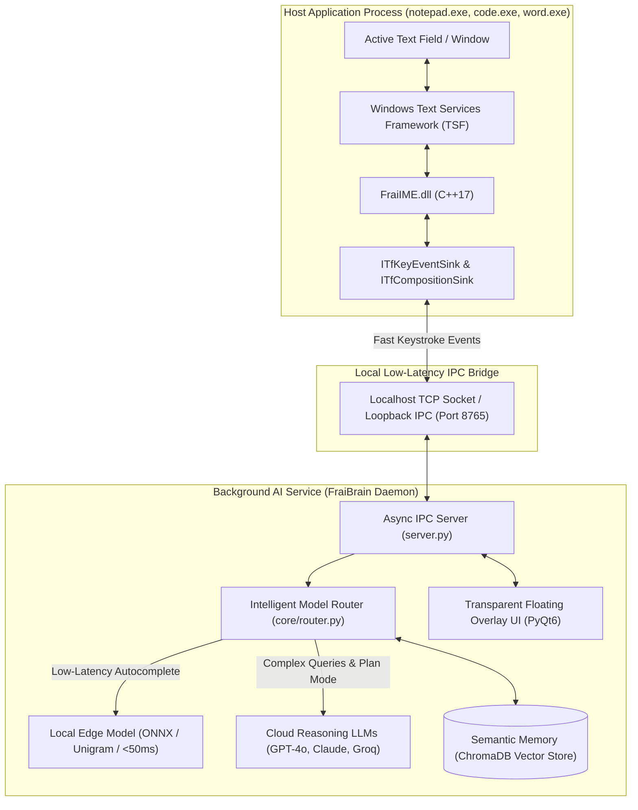
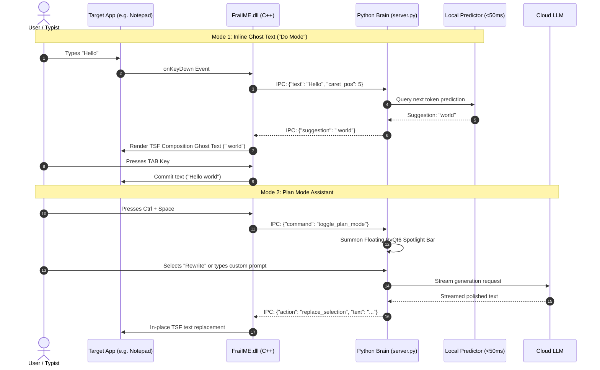

# ⌨️ Frai AI Keyboard - Native Windows IME & Copilot

<p align="center">
  <em>An enterprise-grade, system-wide AI keyboard integrating low-latency C++ Windows Text Services Framework (TSF) with a hybrid edge/cloud Python intelligence engine for real-time ghost text autocomplete, smart autocorrect, and universal in-place rewriting across all Windows applications.</em>
</p>

<p align="center">
  
  
  
  
  
  
  <a href="LICENSE"></a>
</p>

---

## Visual Proof & Live Interface

<p align="center">
  
  
</p>

<p align="center">
  <sub><strong>Left:</strong> Plan Mode Spotlight Overlay floating over an active Windows Notepad session (providing Rewrite, Summarize, Explain, voice dictation, and conversational prompts).<br>
  <strong>Right:</strong> Sub-50ms inline Ghost Text predictive autocomplete rendered directly ahead of the cursor in native text fields.</sub>
</p>

---

## Executive Summary

Most AI writing assistants are isolated to web browsers or individual plugins. **Frai AI Keyboard** re-engineers text input at the **operating system level**. 

By registering as a native **Windows Input Method Editor (IME)** using Microsoft's Text Services Framework (TSF), Frai operates seamlessly across **Notepad, Microsoft Word, VS Code, Slack, Discord, Outlook, Windows Terminal, and any native text field**.

### Flagship Capabilities
- 👻 **Ghost Text Autocomplete ("Do Mode")**: As you type, faint gray text appears ahead of your cursor predicting the next words with sub-50ms latency. Press **`Tab`** to accept the suggestion, or **`Esc`** to dismiss.
- 🪄 **Smart Auto-Correct with Instant Undo**: Swaps common typos on space (e.g. `teh` &rarr; `the`). If you press **`Backspace`** immediately after a correction, the system automatically reverts the edit.
- ✨ **Universal In-Place Rewrite**: Highlight any text in any application, hit your shortcut, and transform grammar, tone, or conciseness directly in place.
- 🧠 **Plan Mode (Spotlight Assistant)**: Press **`Ctrl + Space`** anywhere to summon a floating, transparent Spotlight-style palette with instant actions (**Rewrite**, **Summarize**, **Explain**) or free-form conversational prompting.
- 📎 **Semantic Clipboard Memory**: A background vector database indexes clipboard history, allowing the assistant to recall links, snippets, or code referenced earlier.

---

## Split-Process System Architecture

Frai uses a decoupled, split-process architecture to guarantee operating system stability: the native C++ DLL is kept lean and crash-proof, delegating heavy AI compute to a background Python daemon via high-speed IPC.



---

## Interaction & Execution Flow



---

## Latency & Performance Profile

| Feature | Engine / Layer | Measured Latency | Memory Footprint |
| :--- | :--- | :--- | :--- |
| **Keystroke Interception** | Native C++17 TSF DLL | **< 1 ms** | ~4 MB (in-process) |
| **Ghost Text Autocomplete** | Local Edge Model / IPC | **< 45 ms** | ~50 MB |
| **Smart Auto-Correct** | Circular Buffer Dictionary | **< 5 ms** | Instantaneous |
| **Plan Mode Overlay Launch**| PyQt6 Native Window | **< 80 ms** | ~90 MB (Python daemon) |
| **Cloud Intelligence** | OpenAI GPT-4o / Groq API | Streamed (chunked) | Network bounded |

---

## Quickstart (3 Steps)

### 1. Initialize Python Environment
Clone the repository and run the automated setup batch script:
```cmd
git clone https://github.com/mdumr4/AI-Keyboard.git
cd AI-Keyboard

setup_env.bat
```
*This creates a local Python virtual environment and installs all dependencies (PyQt6, requests, chromadb, etc.).*

### 2. Configure API Keys
Copy the example environment configuration and add your preferred cloud LLM API keys:
```cmd
copy .env.example .env
```
Add your credentials:
```env
OPENAI_API_KEY=sk-your-openai-key
GROQ_API_KEY=gsk-your-groq-key
```

### 3. Start the AI Keyboard
Right-click and run **`start_frai.bat` as Administrator**:
```cmd
start_frai.bat
```
- A console window titled `"Frai AI Backend"` will launch.
- Frai will register `FraiIME.dll` with Windows Text Services Framework.
- Open **Notepad**, start typing, and press **`Tab`** to accept ghost text completions, or hit **`Ctrl + Space`** to summon Plan Mode!

To stop the keyboard cleanly and unregister the DLL:
```cmd
stop_frai.bat
```

---

## Keybindings Cheat Sheet

| Keybinding | Scope | Functionality |
| :--- | :--- | :--- |
| **`Tab`** | Any text field | Accept inline ghost text completion |
| **`Esc`** | Any text field | Dismiss active ghost text suggestion |
| **`Ctrl + Space`** | System-wide | Toggle Plan Mode floating spotlight assistant |
| **`Backspace`** | Immediate typo | Undo automated autocorrect substitution |

---

## Compiling from Source (Developers)

If you are modifying the C++ Text Services Framework core:

### Prerequisites
- **Visual Studio 2022** with C++ Desktop Development (MSVC v143).
- **CMake 3.10+**.
- **Windows 10/11 SDK**.

### Build Instructions
```cmd
# Automated compilation and registration
build_all.bat
```
Or build manually via CMake:
```cmd
cmake -B build -G "Visual Studio 17 2022" -A x64
cmake --build build --config Release
```
Output binary `FraiIME.dll` will be generated in `build/Release/FraiIME.dll` and registered via `regsvr32`.

---

## Repository Structure

```text
AI-Keyboard/
├── assets/                       # UI screenshots and documentation media
│   ├── plan_mode_overlay.png     # Spotlight floating assistant capture
│   └── ghost_text_autocomplete.png # Inline predictive autocomplete capture
├── src/
│   ├── cpp_ime/                  # Native C++ Windows TSF implementation
│   │   ├── FraiTextService.cpp   # Core ITfTextInputProcessorEx implementation
│   │   ├── KeyHandler.cpp        # Low-latency keystroke sink
│   │   ├── AutoCorrect.cpp       # Typo correction & undo session
│   │   ├── BridgeClient.cpp      # High-speed IPC client to Python brain
│   │   ├── EditSession.cpp       # TSF read/write composition sessions
│   │   ├── LayoutSession.cpp     # Caret screen coordinates tracking
│   │   └── FraiIME.def           # COM export definitions
│   ├── python_brain/             # Python AI background daemon
│   │   ├── server.py             # Asynchronous IPC coordinator
│   │   ├── bridge/ipc.py         # Socket protocol handlers
│   │   ├── core/router.py        # Local vs cloud model router
│   │   ├── core/local_llm.py     # Sub-50ms edge predictor
│   │   ├── core/cloud_llm.py     # OpenAI / Groq / Claude connectors
│   │   ├── memory/clipboard.py   # Contextual clipboard watcher
│   │   ├── memory/vector.py      # ChromaDB semantic memory store
│   │   └── ui/                   # Transparent floating PyQt6 UI
│   │       ├── overlay.py        # Topmost spotlight command bar
│   │       └── chat_window.py    # Conversational chat window
│   └── installer/
│       └── register.bat          # IME registration script
├── tests/                        # Test payloads and mock inputs
│   ├── test_autocorrect.json
│   ├── test_chat.json
│   └── test_input.json
├── CMakeLists.txt                # CMake build configuration for C++ DLL
├── FraiIME.dll                   # Pre-compiled 64-bit Windows TSF binary
├── Instruction.md                # Master technical execution manual
├── build_all.bat                 # MSVC compilation & registration script
├── setup_env.bat                 # Python virtualenv installation script
├── start_frai.bat                # Administrator launch daemon
├── stop_frai.bat                 # Clean shutdown & unregistration script
├── requirements.txt              # Python dependencies
├── LICENSE                       # MIT License
├── README.md                     # Portfolio landing page documentation
└── .gitignore                    # Build, IDE, and AI configuration exclusions
```

---

## License

This project is licensed under the [MIT License](LICENSE).
